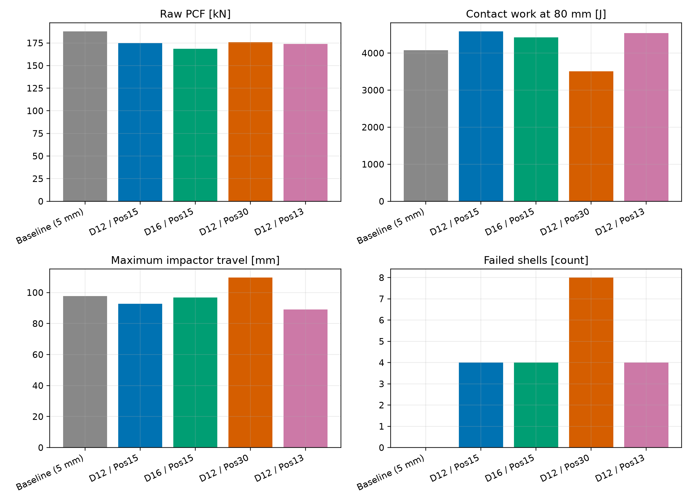

# Aluminium Crash Box — Axial Impact Simulation and Design Comparison

Can two holes near the impacted end of a square aluminium tube reduce its initial force peak without sacrificing the work transferred during crushing? This project investigates that question through five LS-DYNA simulations and a Python analysis of force, motion and energy histories.

The study compares an unperforated tube with four variants that change the hole diameter or distance from the impacted end. It follows the work from CAD and material definition through explicit simulation, solver-diagnostic checks and interpretation of the results.

**The main finding is a trade-off:** the 12 mm holes at a 15 mm position give the highest contact work over the selected 80 mm impactor-travel interval, while the 16 mm holes at the same position give the lowest raw peak force. These are provisional numerical findings. The reference and modified designs use different mesh sizes, and every modified design experiences numerical shell deletion.

## Model and design question

The component is a 200 mm long AA6061-T6 square tube with an 80 × 80 mm external section, 2 mm walls and rounded corners. Its base is fixed, and a rigid impactor approaches the other end at 10 m/s. The solver-reported moving mass is 100.005 kg, giving an initial kinetic energy of 5000.25 J. Each run covers 30 ms.

The modified tubes have two circular holes on opposite walls. The investigation asks how hole size and position alter the force response, work at a common travel distance and final deformation. Position refers to the distance from the impacted tube end to the hole centre.

The model uses fully integrated shells, a literature-based piecewise-linear plasticity table and frictionless impact and self-contact. The retained unperforated reference uses a nominal 5 mm shell mesh; the modified designs use 3 mm shells. All five retained runs use 800 solid elements for the rigid plate.

## Work carried out

I built the final geometry in ANSYS DesignModeler, set up and ran the explicit simulations through Workbench/Mechanical with LS-DYNA, and inspected deformation in LS-PrePost. The design study varied the hole diameter and axial position while retaining the nominal tube dimensions and impact loading.

The Python workflow processes the solver's ASCII outputs, aligns force and impactor-motion histories, integrates contact work to a common endpoint and produces comparison plots and metrics. The review also checks solver-reported masses, energy histories and failed elements, rather than relying only on successful termination or a single performance number.

| Tool | Role |
|---|---|
| ANSYS DesignModeler | Final tube and impactor geometry |
| ANSYS Workbench / Mechanical, LS-DYNA | Model setup and explicit impact simulations |
| LS-PrePost | Deformation inspection |
| Python | Output processing, metrics and plots |

## Results from the retained runs

*The retained runs show different force, work and travel trade-offs. The reference uses a 5 mm shell mesh and the variants use 3 mm meshes; all modified runs contain numerical shell failures.*

| Design | Shell mesh (mm) | Raw peak force (kN) | Contact work at 80 mm (J) | Maximum impactor travel (mm) | Failed shells |
|---|---:|---:|---:|---:|---:|
| Unperforated reference | 5 | 187.876 | 4080.34 | 97.637 | 0 |
| Ø12 mm / position 15 mm | 3 | 174.984 | 4588.31 | 92.680 | 4 |
| Ø16 mm / position 15 mm | 3 | 168.462 | 4422.56 | 96.815 | 4 |
| Ø12 mm / position 30 mm | 3 | 175.726 | 3506.52 | 109.640 | 8 |
| Ø12 mm / position 13 mm | 3 | 174.031 | 4543.58 | 89.089 | 4 |

Contact work is the area under the compression-force versus impactor-travel curve to the first forward passage of 80 mm. This distance includes the initial 2 mm gap and is not a direct measurement of tube shortening. Contact work is also distinct from isolated plastic energy dissipation. Peak force is taken from the raw full-history signal.

The Ø12/15 variant is a provisional candidate when work within the selected interval is the priority. The Ø16/15 variant trades some of that work for a lower raw peak. The Ø12/13 variant records the shortest maximum travel and almost the same work as Ø12/15: their work difference is only about 0.98%, without quantified numerical uncertainty. Moving the 12 mm holes to 30 mm produces the lowest work and greatest maximum travel of the retained designs.

The force histories also show why filtering needs to be reported. An exploratory 11-sample moving average changes the peak-force ranking; it is used for visual interpretation, not as a replacement for the raw results or as a standards-based crash filter.

## What the evidence supports

The simulations expose a useful design trade-off, but they do not establish an optimised or experimentally validated crash box. Three limitations are central to interpreting the table:

- **Mesh effects are not separated from geometry effects.** The 5 mm reference and 3 mm variants do not form a matched-mesh comparison, and convergence has not been demonstrated.
- **The modified runs contain numerical failures.** Negative-Jacobian shell deletion occurs near the impact-end corners. These events are not calibrated predictions of material cracking.
- **The physical model remains idealised.** The material table does not establish rate, temperature or fracture behaviour, and no physical crush test has been used for validation.

A near-unity reported energy ratio does not remove these limitations. Similarly, deformation views of the Ø12/15 case show local end folding and wall bowing, but do not demonstrate stable repeated accordion folding along the tube.

The next technical investigation would use a matched-mesh reference and candidate, followed by controlled mesh/contact sensitivity checks and investigation of the corner failures. These are proposed follow-ups, not completed validation work.

## Explore the engineering details

The [technical report](docs/technical_report.md) documents the geometry, material source, boundary conditions, contact settings, metric definitions, energy histories and interpretation of the five runs. It also distinguishes retained simulation evidence from earlier exploratory trials.

The analysis is based on six solver files per design: `input.k`, `d3hsp`, `rcforc`, `rbdout`, `glstat` and `sleout`. Processing these retained outputs is a separate task from rerunning LS-DYNA: the former reproduces the analysis, while the latter requires the simulation software and model setup. The [reproduction guide](docs/reproducing_results.md) provides the folder layout, installation commands and expected results. Both publication scripts completed successfully on Windows with Python 3.13.2, NumPy 2.5.4 and Matplotlib 3.11.2; the project-root `requirements.txt` records the package versions.

The archived [engineering metrics](docs/results/engineering_metrics.csv) contain the values behind the result table. The [comparison with D12/Pos15](docs/results/comparison_vs_D12_Position15.csv), [parser consistency report](docs/results/validation_report.csv), [method notes](docs/results/method_and_limitations.txt) and [source manifest](docs/results/source_manifest.json) preserve supporting evidence. Generated working outputs remain under `results/`; the selected publication copies are under `docs/results/`.

Material hardening source: M. W. Liu, [“Study on Mechanical Properties of 6061-T6 Aluminum Alloy”](https://hrcak.srce.hr/307378), *Metalurgija*, 63(1), 39–42, 2024. The implementation and its limits are described in the technical report.

**Author:** Sourish Shetty
