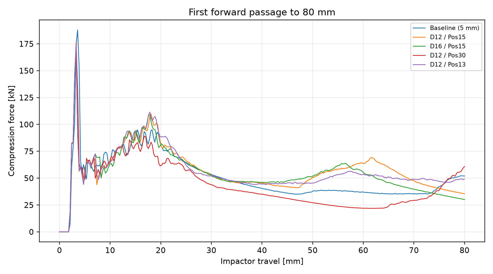
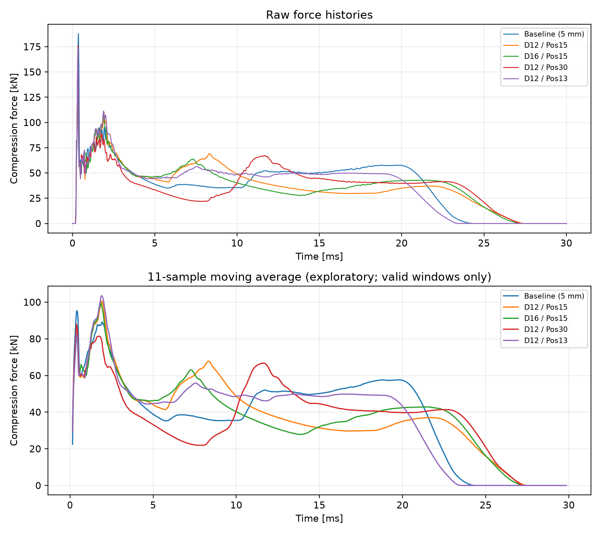
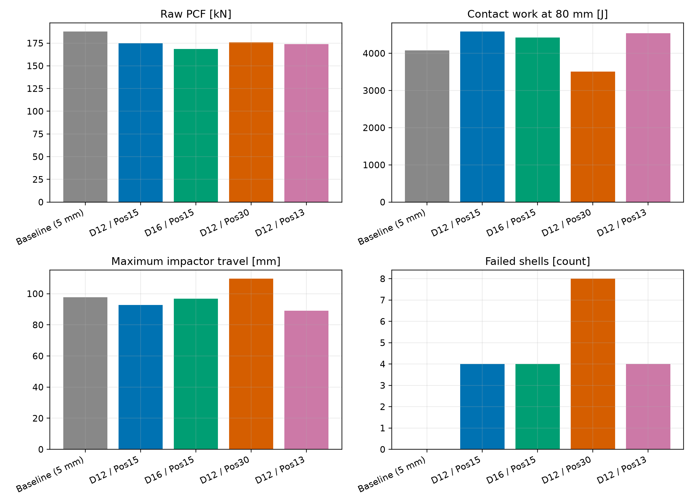
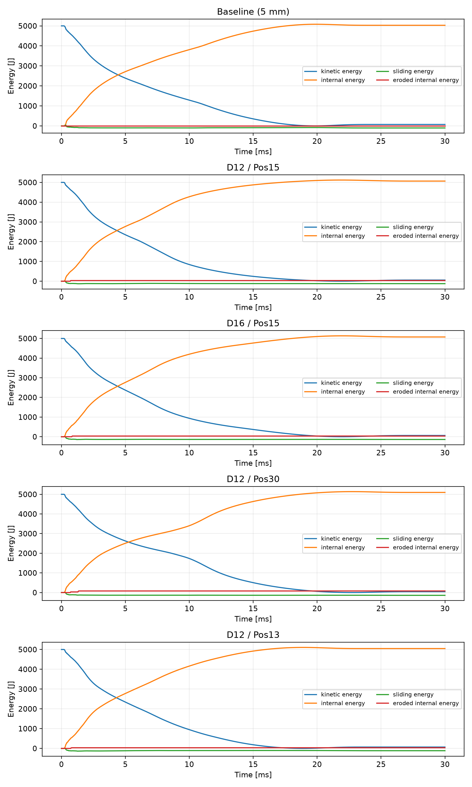
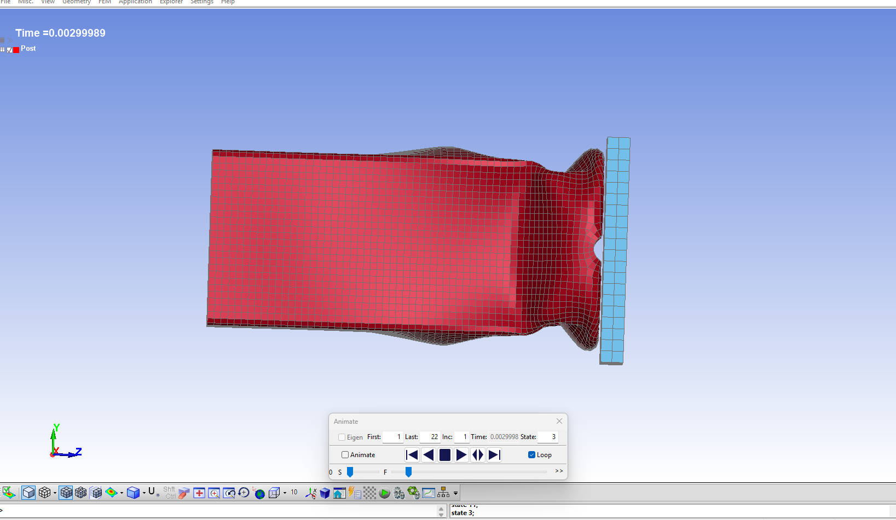
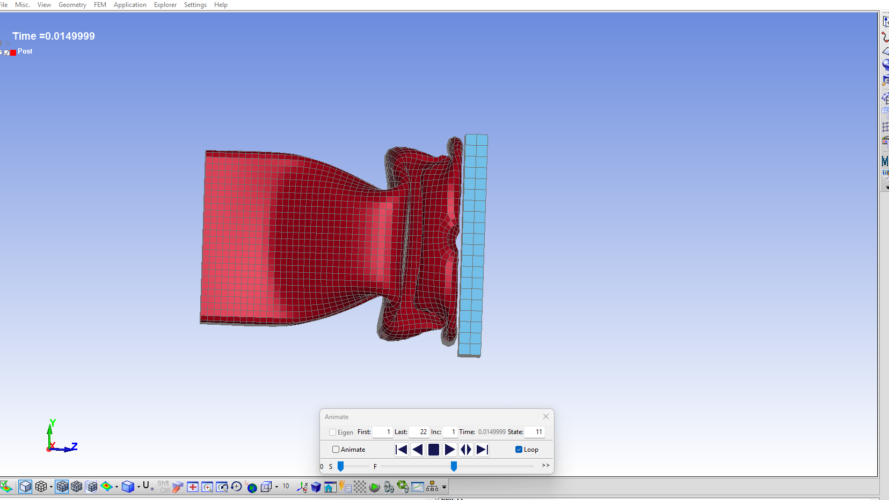
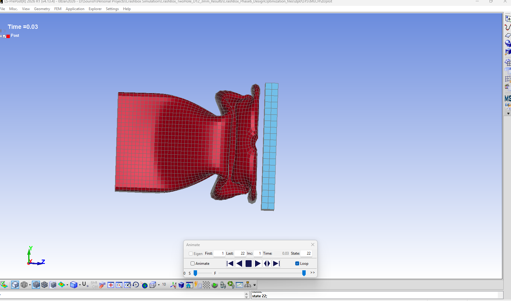
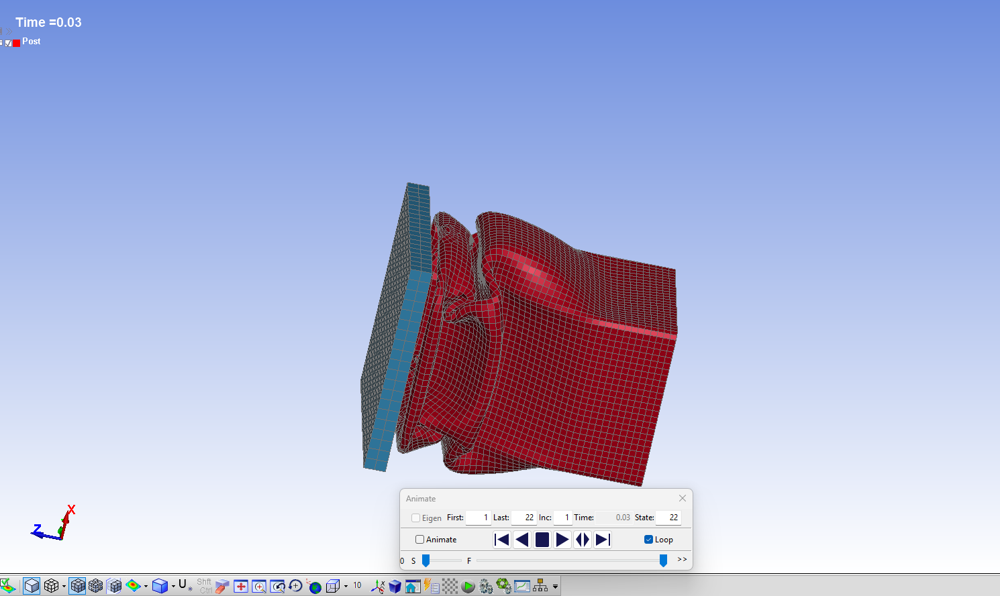

# Axial impact of an aluminium crash box: simulation and design comparison

Sourish Shetty · Technical report · 7 November 2026 

## 1. Purpose and scope

This project investigates how two circular holes near the impacted end of a square aluminium crash box change its simulated axial impact response. The practical question is whether a small geometry change can reduce the initial force peak while maintaining contact work over a common travel distance.

Five retained LS-DYNA runs are compared: an unperforated reference and four perforated variants. The work includes CAD modelling, explicit finite-element simulation, solver-diagnostic review, deformation inspection and Python post-processing. ANSYS DesignModeler supplied the final geometry; Workbench/Mechanical supplied the LS-DYNA setup, and LS-PrePost was used to inspect deformation. NX was explored initially but was not the final geometry workflow because of export restrictions.

This is an exploratory numerical study. The baseline and modified designs use different nominal shell mesh sizes, modified designs exhibit numerical element deletion, and neither experimental validation nor mesh convergence has been demonstrated. The results support a provisional comparison of these saved runs, not a production-ready crashworthiness claim or a demonstrated global optimum.

## 2. Geometry and loading

The crash box is a 200 mm long square tube with a nominal 80 × 80 mm external envelope and 2 mm wall thickness. These dimensions were project design assumptions informed by the general thin-wall crash-box concept; they were not copied from a validated production component.

| Quantity | Value | Evidence or interpretation |
|---|---:|---|
| Tube length | 200 mm | CAD and exported shell coordinates |
| External width and height | 80 × 80 mm | CAD dimensions |
| Internal width and height | 76 × 76 mm | CAD dimensions |
| Wall thickness | 2 mm | Shell section |
| Outer corner radius | 4 mm | CAD corner diameter 8 mm |
| Inner corner radius | 2 mm | CAD corner diameter 4 mm |
| Nominal midsurface corner radius | 3 mm | Derived from uniform thickness |
| Planar wall midplane separation | 78 × 78 mm | Shell coordinates at ±39 mm |
| Impactor dimensions | 100 × 100 × 10 mm | Exported coordinates |
| Initial axial gap | 2 mm | Tube ends at Z = 200 mm; plate starts at Z = 202 mm |
| Added lumped mass | 99.220 kg | Final solver logs |
| Total rigid impactor mass | 100.005 kg | Final solver logs, including plate |
| Initial axial velocity | −10,000 mm/s | Exported model; magnitude 10 m/s |
| Initial kinetic energy | 5000.25 J | Global energy output; consistent with ½mv² |
| Simulation duration | 30 ms | End-time control |

All six listed translational and rotational degrees of freedom are restrained at the tube base, Z = 0. The impactor approaches the free end in the negative Z direction. This idealised loading represents a component-level axial impact; it does not include a vehicle rail, bumper assembly or occupant model.

Each modified design has two holes on opposite walls. Position denotes the axial distance from the impacted tube end to each hole centre.

| Saved-run identifier | Hole diameter | Hole-centre position | Nominal shell mesh |
|---|---:|---:|---:|
| `Baseline_5mm` | None | — | 5 mm |
| `D12_Position15_3mm` | 12 mm | 15 mm | 3 mm |
| `D16_Position15_3mm` | 16 mm | 15 mm | 3 mm |
| `D12_Position30_3mm` | 12 mm | 30 mm | 3 mm |
| `D12_Position13_3mm` | 12 mm | 13 mm | 3 mm |

An initial 150 mm available-stroke allowance and early performance targets were provisional project assumptions, not verified vehicle packaging or regulatory requirements. The 80 mm evaluation distance was selected after initial simulations because all retained runs reached it. It is therefore a common post-processing interval, not a pre-established acceptance criterion.

## 3. Material representation

The crash box uses an AA6061-T6 representation with `*MAT_PIECEWISE_LINEAR_PLASTICITY` (MAT024). Density is 2.7 × 10⁻⁹ tonne/mm³, Young's modulus is 69,000 MPa and Poisson's ratio is 0.33.

The hardening points reproduce the reference-rate relation reported by Liu [1]:

**Flow stress (MPa) = 293.614 + 507.755 × (effective plastic strain)^0.741**

| Effective plastic strain | Flow stress (MPa) |
|---:|---:|
| 0.00 | 293.614 |
| 0.01 | 310.350 |
| 0.02 | 321.586 |
| 0.04 | 340.364 |
| 0.06 | 356.748 |
| 0.08 | 371.749 |
| 0.10 | 385.798 |
| 0.15 | 418.105 |

The source describes a wider constitutive fit, including strain-rate dependence. This project implements the tabulated reference-rate hardening component, not the full Johnson–Cook model. It does not establish calibrated strain-rate, temperature or fracture behaviour. The material failure parameter is zero; subsequent negative-Jacobian shell removal must not be interpreted as predicted physical cracking. Behaviour at strains beyond the last tabulated point is not validated by this material-data check.

## 4. Finite-element and contact setup

The tube uses fully integrated shells (`ELFORM = 16`) with five through-thickness integration points and a middle surface offset. The rigid plate uses 800 solid elements in every retained run. The timestep safety factor is 0.9 and `DT2MS = 0`; the saved setup does not request automatic mass scaling through that parameter. The exported timestep controls include `ERODE = 1`.

| Design | Shell elements | Plate solid elements | Solver-reported box mass (kg) |
|---|---:|---:|---:|
| Baseline | 2560 | 800 | 0.329368 |
| D12 / Pos15 | 6988 | 800 | 0.329671 |
| D16 / Pos15 | 6986 | 800 | 0.328721 |
| D12 / Pos30 | 6996 | 800 | 0.329671 |
| D12 / Pos13 | 6987 | 800 | 0.329671 |

These masses describe the discretised models. In particular, a 12 mm perforated model has a slightly higher reported mass than the coarse unperforated reference. This should not be presented as a physical mass increase caused by removing material; the reference and variants are differently discretised. Specific-work calculations below use the actual solver-reported mass of each model.

Impactor contact uses `*CONTACT_AUTOMATIC_SURFACE_TO_SURFACE_ID` (interface 48). Tube self-contact uses `*CONTACT_AUTOMATIC_SINGLE_SURFACE_ID` (interface 38). Both have zero static and dynamic friction, `VDC = 10`, `SOFT = 2`, `SBOPT = 3` and `DEPTH = 5`.

The baseline and modified impact-contact cards differ in the optional `SOFSCL` entry, recorded as 0 and 0.1 respectively. This entry controls the SOFT = 1 formulation; ANSYS documents that SOFT = 2 uses SLSFAC instead [2]. The retained runs have matching SLSFAC and SFS/SFM inputs. Accordingly, the SOFSCL difference is not evidence of a deliberate active stiffness-scale change. Matching scale-factor inputs do not establish identical effective contact stiffness: SOFT = 2 stiffness also depends on the discretisation and timestep [3].

The final solver files give 99.220 kg of lumped mass and 100.005 kg total rigid mass in all five cases. These values supersede an earlier 99.215 kg added-mass value in the project record.

## 5. Post-processing method

The retained evidence comprises `input.k`, `d3hsp`, `rcforc`, `rbdout`, `glstat` and `sleout` for each design. Python converts the ASCII histories into normalised tables and then calculates engineering metrics. The N–mm–s system uses tonnes for mass; N·mm values are divided by 1000 to obtain joules.

Compression force is defined as minus the Z force on the SURFA side of interface 48. Positive impactor travel is obtained from rigid-body 2 motion along the impact direction. Motion is interpolated onto force timestamps only within their overlapping time support; it is not extrapolated.

The common interval ends at the first forward passage to 80 mm, with an interpolated endpoint. A reversal before the endpoint is rejected by the analysis. The coordinate is **impactor travel from its initial position**, including the initial gap, rather than a direct measurement of tube shortening. Force is approximately zero before contact, so the free-travel portion contributes negligible work; it still belongs to the 80 mm distance used to calculate mean force.

The metrics are:

| Metric | Definition |
|---|---|
| Contact work at 80 mm (J) | Area under the compression-force versus impactor-travel curve from 0 to 80 mm, calculated by trapezoidal integration. Divide the area in N·mm by 1000 to obtain J. |
| Mean contact force to 80 mm (kN) | Contact work at 80 mm (J) ÷ 80 (mm). Numerically, 1 J/mm = 1 kN. |
| Raw peak contact force, PCF (kN) | Maximum compression force over the full retained history, expressed in kN. |
| Force efficiency (%) | 100 × mean contact force to 80 mm ÷ raw PCF, with both forces in kN. |
| Contact-work specific energy, SEA (kJ/kg) | Contact work at 80 mm (J) ÷ [1000 × crash-box mass (kg)]. |

These definitions must accompany comparisons with other studies: contact work is not isolated plastic dissipation, and this efficiency ratio uses an 80 mm mean with a full-history raw peak. Specific energy uses the crash-box mass only, excluding the impactor.

An 11-sample moving average is provided for exploratory visualisation. Only complete windows are used, without zero padding. The first-to-last sample span is approximately 0.30 ms. The same window is applied to all designs; it is not a standards-based crash filter. Raw metrics remain separate from smoothed peaks.

Model masses and element counts come from `d3hsp`. An early parser counted solid-element text lines instead of elements. The publication parser corrects this count; Script 2 independently uses the solver inventory. The authoritative count is 800 solids in each retained run.

## 6. Results

### 6.1 Force and contact work

*Figure 1. Force over the common 80 mm impactor-travel interval. The area under each curve is the reported contact work. Travel includes the initial gap; it is not a direct measurement of tube shortening.*

| Design | Raw PCF (kN) | Work at 80 mm (J) | Mean force to 80 mm (kN) | Force efficiency (%) | Contact-work SEA (kJ/kg) |
|---|---:|---:|---:|---:|---:|
| Baseline | 187.876 | 4080.34 | 51.004 | 27.148 | 12.388 |
| D12 / Pos15 | 174.984 | 4588.31 | 57.354 | 32.777 | 13.918 |
| D16 / Pos15 | 168.462 | 4422.56 | 55.282 | 32.816 | 13.454 |
| D12 / Pos30 | 175.726 | 3506.52 | 43.832 | 24.943 | 10.636 |
| D12 / Pos13 | 174.031 | 4543.58 | 56.795 | 32.635 | 13.782 |

All five raw histories contain a sharp initial contact peak, at approximately 0.33–0.36 ms. D12/Pos15 records the highest contact work at 80 mm, while D16/Pos15 records the lowest raw peak. Against the retained baseline, their numerical work changes are approximately +12.45% and +8.39%, with raw-peak reductions of approximately 6.86% and 10.33%. These are differences between the saved runs; the mesh mismatch prevents attributing the full change to the holes.

Among the modified designs, D12/Pos13 records 44.73 J less work than D12/Pos15, a difference of about 0.98%. Numerical uncertainty has not been quantified, so that small work advantage does not establish robust superiority.

### 6.2 Travel, smoothing and deletion

*Figure 2. Raw and exploratory smoothed force histories. The moving average suppresses the short initial spike and changes the peak ranking. The panels have different vertical scales; numerical peak values are reported separately.*

| Design | Maximum impactor travel (mm) | MA11 peak (kN) | Failed shells |
|---|---:|---:|---:|
| Baseline | 97.637 | 95.359 | 0 |
| D12 / Pos15 | 92.680 | 100.622 | 4 |
| D16 / Pos15 | 96.815 | 99.434 | 4 |
| D12 / Pos30 | 109.640 | 87.947 | 8 |
| D12 / Pos13 | 89.089 | 103.510 | 4 |

D12/Pos13 has the smallest maximum travel but the highest moving-average peak. D12/Pos30 has the lowest moving-average peak yet the lowest 80 mm contact work and largest maximum travel. Thus a design ranking changes with the metric and filtering choice; a low smoothed peak alone is insufficient evidence of a better crash box.

The modified-run failures occur at the impact-end corners, rather than at the hole circumferences. Their reported times are approximately 0.710–0.718 ms for D12/Pos15, 0.818–0.825 ms for D16/Pos15, 0.691–1.331 ms for D12/Pos30 and 0.729–0.791 ms for D12/Pos13. They occur after the initial raw peak but before much of the work accumulation. Timing alone does not establish that any reported metric is insensitive to the numerical instability.

*Figure 3. Overview of the retained numerical results. Lower peak force, greater work and shorter travel do not identify the same candidate. Failed-shell counts are numerical diagnostics, not physical crack counts.*

### 6.3 Energy histories

*Figure 4. Energy histories over the 30 ms simulations. Internal energy rises as kinetic energy decreases. Negative sliding/contact energy and numerical deletion must be considered when interpreting the balance; internal energy above the initial kinetic energy is not evidence of greater than 100% physical absorption.*

All runs begin at 5000.25 J kinetic energy. The following values are the reported global/contact quantities at the final output time, rounded to two decimals.

| Design | Final kinetic energy (J) | Final internal energy (J) | Final sliding energy (J) | Eroded internal energy (J) | Final reported energy ratio |
|---|---:|---:|---:|---:|---:|
| Baseline | 72.73 | 5029.50 | −101.98 | 0.00 | 1.00000 |
| D12 / Pos15 | 57.81 | 5066.96 | −124.24 | 32.77 | 1.00006 |
| D16 / Pos15 | 63.91 | 5076.43 | −139.69 | 34.78 | 1.00008 |
| D12 / Pos30 | 45.74 | 5095.81 | −141.24 | 80.55 | 1.00001 |
| D12 / Pos13 | 69.01 | 5047.34 | −115.86 | 34.00 | 1.00005 |

The histories show a large reduction in kinetic energy and growth in internal energy. Negative sliding/contact energy accompanies internal-energy values slightly above the initial kinetic energy. These values are not evidence of more than 100% physical absorption. Nor should sliding energy in this frictionless model be described as frictional dissipation.

Final hourglass energy is reported as zero. The reported energy ratio remains close to unity, but that does not establish accurate contact, converged force peaks or reliable folding. Eroded internal energy is reported separately here; it has not been independently added to the internal-energy history to create a new balance, which could double-count terms depending on solver accounting.

### 6.4 Deformation inspection

LS-PrePost views of D12/Pos15 at approximately 3, 15 and 30 ms show deformation initiating near the impacted end. The early view contains a local end fold while much of the tube remains comparatively straight. Later views show a compact end fold together with substantial inward wall bowing; the oblique final view also exposes outward deformation of adjacent walls.

*Figure 5. D12/Pos15 at approximately 3 ms. A fold has developed near the impacted end while much of the tube remains comparatively straight. The displayed solver time is approximately 0.003 s.*

*Figure 6. D12/Pos15 at approximately 15 ms. The impacted region is more compact, and the visible wall bows inward behind the end fold. The displayed solver time is approximately 0.015 s.*

*Figure 7. D12/Pos15 at the final recorded time of 30 ms. The local end fold and wall distortion remain visible. A final-time image alone does not establish the point of maximum compression or a rebound-free state.*

*Figure 8. Oblique view of the same design at 30 ms. This view exposes outward deformation of adjacent walls that is less apparent in the side views. Camera orientation and framing differ between captures; image dimensions should not be used to measure shortening.*

This evidence supports localised end folding and wall distortion. It does not establish repeated, stable accordion folding throughout the tube, perfect symmetry or a validated physical failure mechanism. The detailed visual sequence reviewed belongs to D12/Pos15 and should not be presented as a deformation review of every variant.

## 7. Numerical development and limitations

Earlier project records include reduced-integration and fully integrated shell trials, different shell sizes, and contact experiments. Some earlier mesh trials also changed the impactor discretisation, so they are not a controlled single-variable convergence sequence. Contact-damping and contact-stiffness experiment files are not evidence that a corresponding improved run became the accepted configuration. The five retained simulation datasets govern the results in this report.

The interpretation is limited by:

1. **Unmatched reference mesh.** The unperforated reference uses 5 mm shells and the variants use 3 mm shells. A matched comparison is required to separate geometry and discretisation effects.
2. **No demonstrated convergence.** A stable run and a near-unity energy ratio do not establish mesh-independent work, peak force or deformation.
3. **Numerical deletion.** All modified designs lose shells following negative-Jacobian failures. Deleted-element counts are diagnostic quantities, not calibrated crack predictions.
4. **Material scope.** A literature-based hardening table replaces specimen-specific calibration. Rate, temperature and fracture sensitivity remain unvalidated.
5. **Idealised boundaries and contact.** The rigid impactor, frictionless interfaces, fixed base and axial loading omit assembly compliance, friction variation and oblique impact.
6. **Metric dependence.** The comparison interval was chosen after initial runs, impactor travel is not identical to tube shortening, and moving-average peak rankings differ from raw rankings.
7. **No physical validation.** No experimental force–travel curve or crush test has been used to validate the model.

These limitations constrain design claims but do not erase the useful outcome: a traceable workflow that exposes trade-offs and identifies the checks needed before stronger conclusions are warranted.

## 8. Provisional engineering assessment

D12/Pos15 is the provisional candidate for further study when the priority is contact work within the selected 80 mm travel interval. D16/Pos15 is a relevant alternative when reducing raw peak force receives greater weight. D12/Pos13 merits retention because it combines comparable work with the shortest maximum travel, although its exploratory smoothed peak is higher. D12/Pos30 is less attractive under the combined work-and-travel criteria used here.

No weighted objective, uncertainty bounds or sufficiently broad design search has been established to select an optimum. The immediate technical follow-up would be a matched-mesh unperforated reference and candidate comparison, followed by controlled mesh/contact sensitivity checks and investigation of the impact-end element failures. Material calibration and physical testing would be needed for validation beyond this numerical study. These are proposed follow-ups, not completed work.

## 9. Evidence and reproduction record

| Evidence | Role |
|---|---|
| Per-design `input.k` | Exported geometry, material, contact and control definitions |
| Per-design `d3hsp` | Solver masses, element inventory and failure diagnostics |
| `rcforc` and `rbdout` | Interface force and rigid-impactor motion |
| `glstat` and `sleout` | Global and contact-energy histories |
| [engineering_metrics.csv](results/engineering_metrics.csv) | Numerical values underlying the tables |
| [comparison_vs_D12_Position15.csv](results/comparison_vs_D12_Position15.csv) | Numerical comparisons against D12/Pos15 |
| [validation_report.csv](results/validation_report.csv) | Parsing and consistency checks for five designs |
| [method_and_limitations.txt](results/method_and_limitations.txt) | Analysis definitions saved by Script 2 |
| [source_manifest.json](results/source_manifest.json) | Hashes of both scripts and raw/processed inputs |
| `01_force_time.png` | Raw and exploratory smoothed force histories |
| `02_force_travel_80mm.png` | Force against first forward travel to 80 mm |
| `03_energy_histories.png` | Energy histories for the five runs |
| `04_design_comparison.png` | Peak force, work, travel and deletion comparison |
| CAD dimension screenshot | External/internal section dimensions and corner radii |
| D12/Pos15 deformation screenshots | Qualitative views at 3, 15 and 30 ms |

Tables in this report use the retained engineering-analysis output, with rounding only for presentation. Figures are linked from `docs/figures/`. The [reproduction guide](reproducing_results.md) records the tested environment and commands for regenerating the outputs. File hashes identify the particular outputs; they do not constitute independent physical validation.

## References

1. M. W. Liu, “Study on Mechanical Properties of 6061-T6 Aluminum Alloy,” *Metalurgija*, 63(1), 39–42, 2024. [Article record](https://hrcak.srce.hr/307378); [full text](https://hrcak.srce.hr/en/file/443693). Reference-rate hardening fit: p. 41, equations and parameter table.
2. ANSYS, *LS-DYNA User's Guide*, “Contacts and Body Interactions.” [Contact parameter documentation](https://ansyshelp.ansys.com/public/Views/Secured/corp/v252/en/lsdyna_ug/exd_ag_lsdyna_contact_body_inter.html). Used to interpret SOFSCL versus SLSFAC; the project software is 2026 R1, while this linked documentation is 2025 R2.
3. ANSYS LS-DYNA support, [Contact stiffness influenced by time step size](https://lsdyna.ansys.com/contact-stiffness-influenced-by-time-step-size/). Used to qualify the interpretation of matching SOFT = 2 scale-factor inputs.
